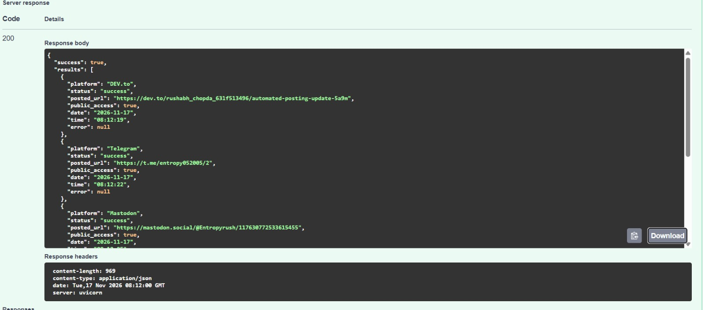
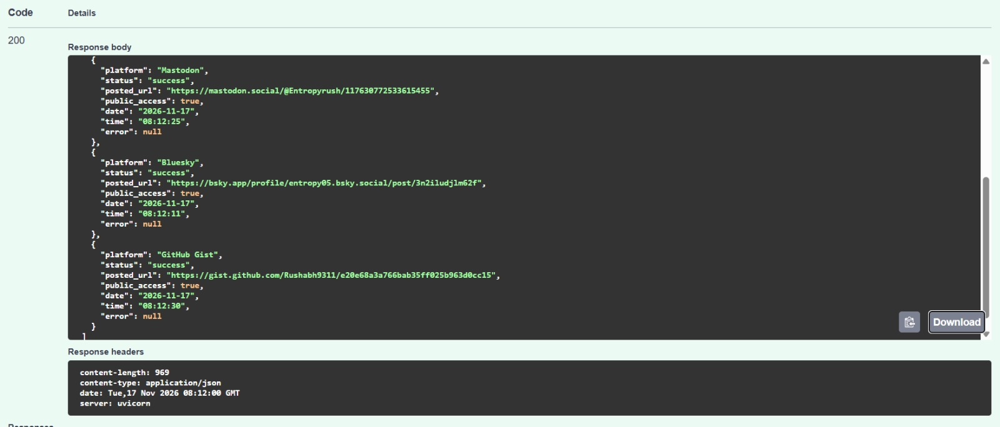
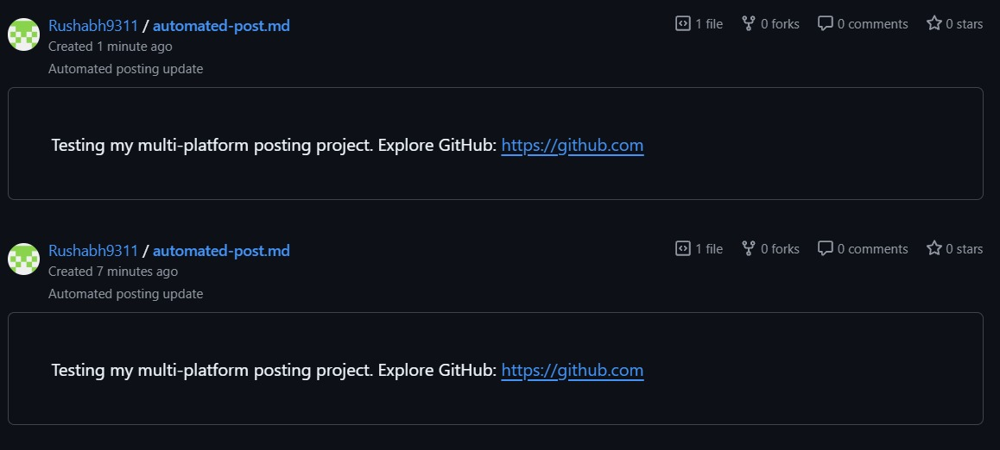

# Automated Multi-Platform Posting API

A beginner-friendly FastAPI service that accepts one short message and publishes it through five platform APIs:

- DEV.to
- Telegram
- Mastodon
- Bluesky
- GitHub Gists

The API validates the message before posting. Each platform is handled independently, so a failure on one platform does not stop the others. The response includes an individual status and any available post URL, public-access flag, date, time, or error.

## Requirements

- Python 3.9 or newer
- Accounts and API credentials for the platforms you want to use
- A public Telegram channel with a bot allowed to post
- A GitHub account and a fine-grained personal access token with Gists write permission

## Setup on Windows PowerShell

Open PowerShell in this project folder and run:

```powershell
py -m venv .venv
.\.venv\Scripts\Activate.ps1
python -m pip install -r requirements.txt
```

If PowerShell blocks activation in the current terminal, run:

```powershell
Set-ExecutionPolicy -Scope Process -ExecutionPolicy Bypass
.\.venv\Scripts\Activate.ps1
```

Create a local `.env` file from `.env.example` if you do not already have one:

```powershell
Copy-Item .env.example .env
```

Add your own credentials to `.env`. Leave credentials blank for platforms you have not configured yet. Do not commit `.env`; it is ignored by `.gitignore`.

## Credentials

| Variable | Value |
| --- | --- |
| `DEVTO_API_KEY` | API key from DEV.to settings |
| `TELEGRAM_BOT_TOKEN` | Token from the bot you created with @BotFather |
| `TELEGRAM_CHANNEL` | Public channel username, such as `@mychannel`; add the bot as an administrator with permission to post |
| `MASTODON_URL` | Base URL of your Mastodon server, such as `https://mastodon.social` |
| `MASTODON_ACCESS_TOKEN` | User access token with the `write:statuses` scope |
| `BLUESKY_HANDLE` | Bluesky account handle, such as `name.bsky.social` |
| `BLUESKY_APP_PASSWORD` | Bluesky app password, not the account password |
| `GITHUB_TOKEN` | Fine-grained personal access token with **Gists: write** permission |

The `.env.example` file contains placeholders only. Keep real tokens and passwords in `.env` and out of source control.

## Run the API

From the project folder, with `.venv` active, run:

```powershell
uvicorn app.main:app --host 0.0.0.0 --port 4000
```

Open the interactive API page at [http://localhost:4000/docs](http://localhost:4000/docs).

## Send a post

The only posting endpoint is `POST /posting`. It accepts a message up to 200 characters long with exactly one valid HTTP or HTTPS link.

Example request (replace the example link with the URL you intend to share):

```json
{
  "message": "Testing my multi-platform posting project. Explore GitHub: https://github.com"
}
```

Each request sends the message to every configured platform in `app/main.py`. A successful request creates real public content on platforms whose credentials are configured. Avoid repeated requests while trying the API; each request can create another post.

## Successful live posting results

The following is the actual response from a successful run on **2026-11-17**. All five platforms returned `success`, and each result included a public post URL.

```json
{
  "success": true,
  "results": [
    {
      "platform": "DEV.to",
      "status": "success",
      "posted_url": "https://dev.to/rushabh_chopda_631f513496/automated-posting-update-5a9m",
      "public_access": true,
      "date": "2026-11-17",
      "time": "08:12:19",
      "error": null
    },
    {
      "platform": "Telegram",
      "status": "success",
      "posted_url": "https://t.me/entropy052005/2",
      "public_access": true,
      "date": "2026-11-17",
      "time": "08:12:22",
      "error": null
    },
    {
      "platform": "Mastodon",
      "status": "success",
      "posted_url": "https://mastodon.social/@Entropyush/117630772533615455",
      "public_access": true,
      "date": "2026-11-17",
      "time": "08:12:25",
      "error": null
    },
    {
      "platform": "Bluesky",
      "status": "success",
      "posted_url": "https://bsky.app/profile/entropy05.bsky.social/post/3n2iludj1m62f",
      "public_access": true,
      "date": "2026-11-17",
      "time": "08:12:11",
      "error": null
    },
    {
      "platform": "GitHub Gist",
      "status": "success",
      "posted_url": "https://gist.github.com/Rushabh9311/e20e68a3a766bab35ff025b963d0cc15",
      "public_access": true,
      "date": "2026-11-17",
      "time": "08:12:30",
      "error": null
    }
  ]
}
```

### Screenshots

These screenshots show the API's successful response and the public GitHub Gist post.







The overall `success` field is `true` when at least one platform succeeds. A failed platform includes its error while the service continues with the remaining platforms.

## Run offline unit tests

The unit tests check message validation and platform failure handling with small fake platforms. They do not contact external APIs or publish posts.

```powershell
python -m unittest discover -s tests
```

## Project layout

```text
app/
  main.py
  schemas.py
  config.py
  platforms/
    base.py
    platform_a.py  # DEV.to
    platform_b.py  # Telegram
    platform_c.py  # Mastodon
    platform_d.py  # Bluesky
    platform_e.py  # GitHub Gist
  services/
    posting_service.py
tests/
  test_posting.py
docs/
  screenshots/  # Live API response and public-post evidence
.env.example
requirements.txt
README.md
```
